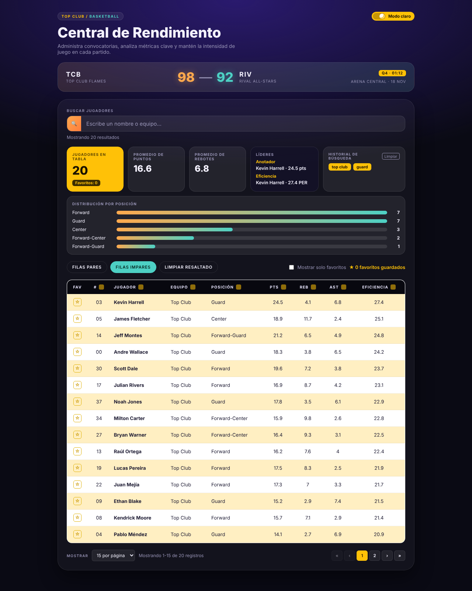
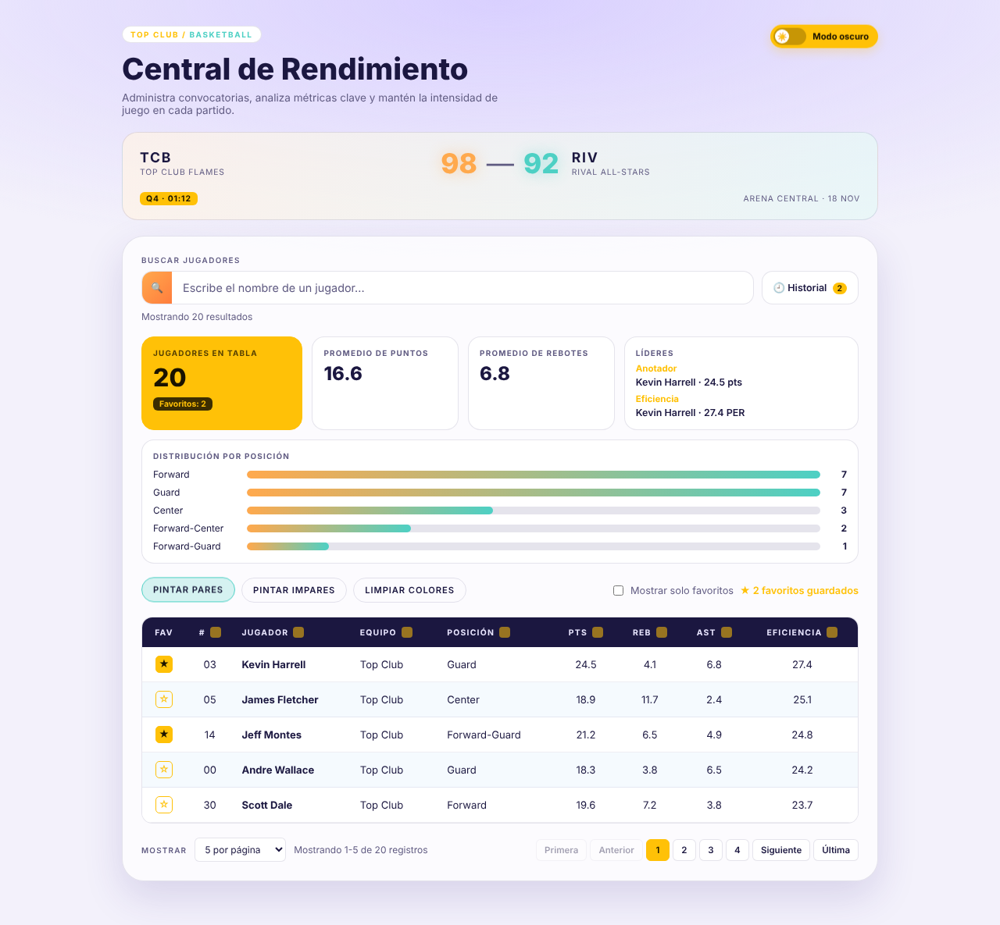
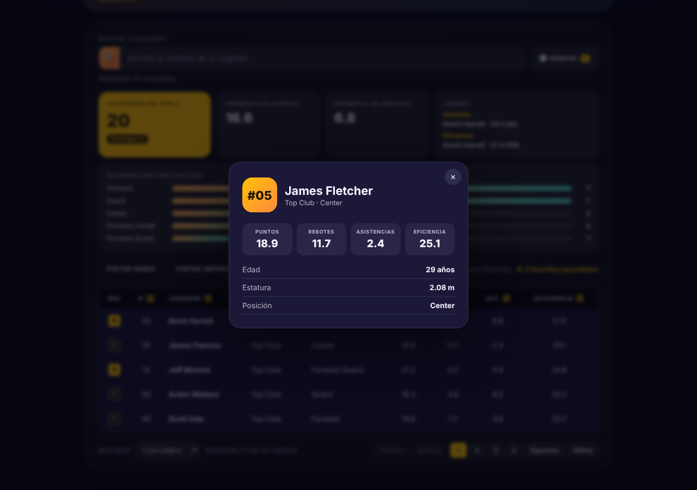
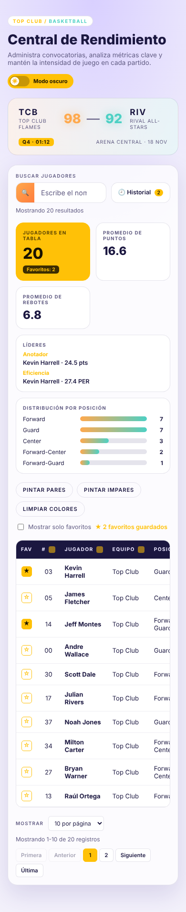

# 🏀 Central de Rendimiento · Examen 2 Basketball

Aplicación React (Vite) con una tabla interactiva de jugadores de basketball. Es el Trabajo Final de **Programación IV (Tarea 10)**: evaluación de Hooks y conceptos fundamentales de React.

- **Integrantes:** _(escriban aquí los nombres del equipo)_
- **Deploy en Netlify:** _(pegar el link del sitio)_
- **Repositorio:** _(pegar el link de GitHub/GitLab/Bitbucket)_
- **IA utilizada:** Claude (Anthropic, modelo Claude Sonnet 5.5) — generó la base del código y la documentación; el equipo la revisó y ajustó.

## 📝 Descripción

Panel con marcador del partido, buscador con debounce, estadísticas en tiempo real, tabla con ordenamiento, paginación, favoritos, modal de detalle, historial de búsquedas y modo oscuro/claro. Los datos son de ejemplo (roster "Top Club", 20 jugadores) y están en `src/data/players.js`.

## 💿 Instalación

```bash
npm install
npm start        # servidor de desarrollo en http://localhost:5173
npm run build    # genera la carpeta dist/ para producción
```

Deploy en Netlify: conectar el repositorio (el archivo `netlify.toml` ya define `npm run build` y la carpeta `dist`).

## ✅ Funcionalidades (puntos 12 al 21)

| # | Funcionalidad | Dónde |
|---|---|---|
| 12 | Búsqueda (nombre, equipo o posición) con debounce de 300 ms, contador "Mostrando X resultados" y botón ✕ | `SearchBar`, `App` |
| 13 | Pintar pares / impares / limpiar colores (clases CSS condicionales) | `App`, `PlayerTable` |
| 14 | Paginación dinámica (5/10/15/20, 15 por defecto), Primera/Anterior/números/Siguiente/Última, "Mostrando X-Y de Z", reset al filtrar | `Pagination`, `App` |
| 15 | Ordenamiento por columna (sin orden → ↑ → ↓ → sin orden) | `PlayerTable`, `App` |
| 16 | Modo oscuro/claro con `localStorage` | `ThemeToggle`, `App` |
| 17 | Estadísticas con `useMemo` (total, prom. puntos/rebotes, líderes, barras por posición) | `StatsPanel`, `App` |
| 18 | Modal de detalle (overlay, ✕, clic fuera, Esc, fade-in/out) | `Modal` |
| 19 | Favoritos ★/☆, filtro "solo favoritos", contador y persistencia | `PlayerRow`, `App` |
| 20 | Historial de las últimas 5 búsquedas, restaurar y limpiar, persistido | `SearchHistory`, `App` |
| 21 | Componentes reutilizables con props | `src/components` |

## 🎣 Hooks utilizados

| Hook | Propósito en el proyecto |
|---|---|
| `useState` | Término de búsqueda, página actual, elementos por página, `sortConfig`, `rowColors`, `darkMode`, `favorites`, `showOnlyFavorites`, `selectedPlayer`, `isModalOpen`, `searchHistory`, apertura del dropdown de historial |
| `useEffect` | Debounce con cleanup (`clearTimeout`), guardar historial, persistir `darkMode`/`favorites`/`searchHistory` en `localStorage`, resetear la página al filtrar, cerrar el modal con Escape (cleanup del listener) y animación de salida |
| `useMemo` | `filteredPlayers`, `sortedPlayers`, `stats` y `pagePlayers`: solo se recalculan si cambian sus dependencias |

## 🗂️ Estructura

```
src/
├── App.jsx                 # estado global y lógica (levantamiento de estado)
├── main.jsx
├── data/players.js         # 20 jugadores
├── utils/
│   ├── playerUtils.js      # promedio, top, distribución, ordenamiento, páginas visibles
│   └── storage.js          # lectura/escritura segura de localStorage
├── components/
│   ├── SearchBar.jsx       # value, onChange, onClear, resultsCount
│   ├── SearchHistory.jsx   # history, onSelectSearch, onClearHistory
│   ├── StatsPanel.jsx      # stats, darkMode
│   ├── PlayerTable.jsx     # players, onRowClick, onSort, sortConfig, darkMode, rowColors
│   ├── PlayerRow.jsx       # player, index, onClick, isFavorite, onToggleFavorite, darkMode, colorClass
│   ├── Pagination.jsx      # currentPage, totalPages, onPageChange, itemsPerPage, onItemsPerPageChange, totalItems
│   ├── Modal.jsx           # isOpen, onClose, player, darkMode
│   ├── ThemeToggle.jsx     # darkMode, onToggle
│   ├── PageHeader.jsx      # encabezado + ThemeToggle
│   ├── Scoreboard.jsx      # marcador del partido
│   └── Toolbar.jsx         # pintar filas y filtro de favoritos
└── styles/                 # un CSS por componente, nomenclatura BEM
```

## 📸 Capturas

| Modo oscuro | Modo claro (pares pintados) |
|---|---|
|  |  |

| Modal de detalle | Responsive |
|---|---|
|  |  |
